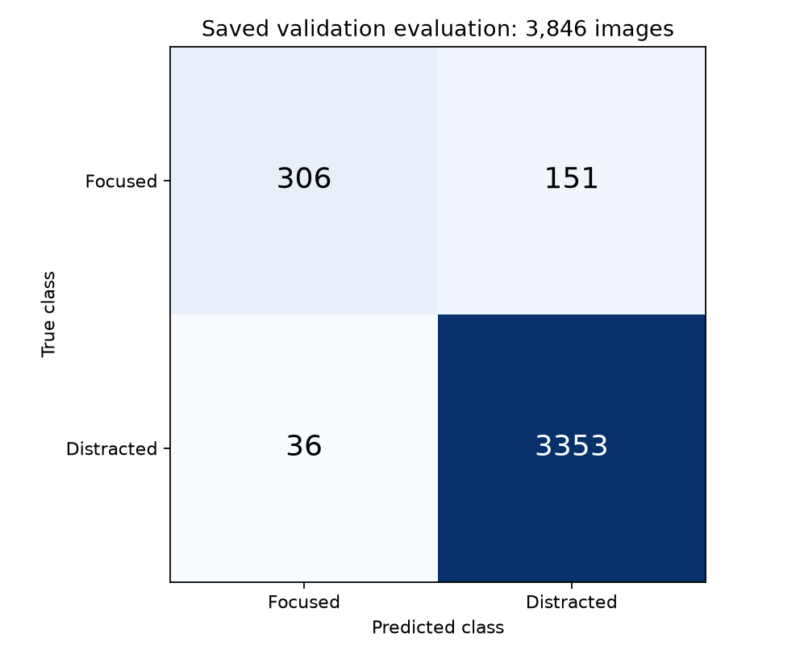
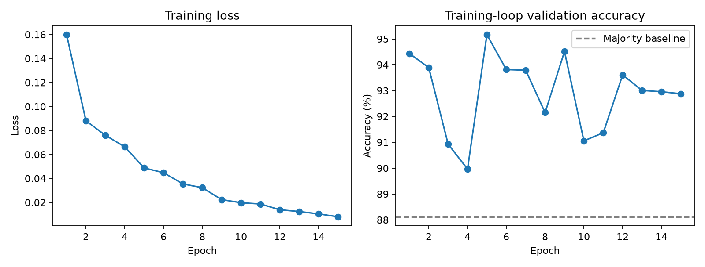

# Distracted-driver classification with YOLO11n

A computer-vision course project using the State Farm in-cabin image dataset. I trained a pretrained YOLO11n image classifier on a binary task: `c0` is focused driving and `c1` through `c9` are grouped as distracted. This is image classification, not bounding-box detection.

**Saved result:** 95.14% validation accuracy versus an 88.12% always-distracted baseline, with macro F1 0.8694. The main weakness is focused-driver recall: 66.96%. Accuracy alone hides that error pattern.

## Evaluation and evidence

The recorded split contains 18,578 training images and 3,846 validation images. Five drivers are reserved for validation, with no driver intentionally assigned to both partitions. The source code selects driver IDs before copying/symlinking images. See the [saved split summary](evidence/split_summary.json).

| Class | Precision | Recall | F1 | Images |
|---|---:|---:|---:|---:|
| Focused | 0.8947 | 0.6696 | 0.7660 | 457 |
| Distracted | 0.9569 | 0.9894 | 0.9729 | 3,389 |

Weighted F1: 0.9483. Macro F1: 0.8694. Results are from the [saved evaluation summary](evidence/validation_metrics_summary.txt), whose arithmetic was checked against the confusion counts. These are historical results, not a new independent reproduction.



The validation set was also used during training/checkpoint selection. It is **not an untouched final test set**, and one five-driver split does not establish reliability across all drivers or real-world deployment.

## Method

- Pretrained `yolo11n-cls.pt`; 224-pixel inputs, batch size 32 and 15 epochs.
- Seed 42 for driver selection and training.
- Horizontal flips, HSV variation, scaling and random erasing.
- Per-class precision/recall/F1, majority baseline and qualitative error inspection.



The [training log](evidence/results.csv) peaks at 95.164% in epoch 5. The separate evaluation summary reports 95.1378%, one correct image fewer on this split. The exact reason is unverified; these are kept as separate measurements rather than silently merged.

## Files and running

- [Training and driver split](project2train.py)
- [Classification metrics and validation](project2validate.py)
- [Original submitted report](project2_report.pdf)

Install with `python -m pip install -r requirements.txt`. The original package versions are not recorded; this dependency list is not a historical environment lock.

```sh
python project2train.py --dataset /path/to/state-farm --output binary_dataset --device cpu
python project2validate.py --data binary_dataset/val --weights runs/level1_binary/weights/best.pt --output new_metrics.txt --device cpu
python -m unittest discover -s tests -v
```

Use `--device 0` for a supported CUDA GPU or `--device mps` on compatible Macs. `--prepare-only` builds the split without loading Ultralytics. Paths are configurable; existing split directories, named training runs and evaluation output files are refused. Images are copied by default; optional `--link-mode symlink` may require privileges on Windows. The tests check split isolation, preservation of existing files and metric edge cases, without training a model.

The dataset and trained weights are not included in this standalone repository. Obtain authorized dataset access and provide `driver_imgs_list.csv` plus `imgs/train/c0` through `c9`. No new training was performed when preparing this README.

## Historical figure correction

The original `confusion_matrix_clean.png` shows different counts (345/112/114/3275), and `training_curve_clean.png` shows ten epochs rather than the fifteen in the saved CSV. They are preserved as historical files but are not the evidence for the metrics above. The new `evidence/` figures are regenerated directly from the saved numerical records. The original PDF remains unchanged. The qualitative example image has not been matched to saved per-image predictions.
